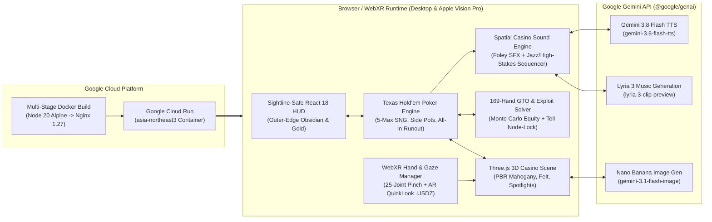

# Monte Carlo VIP 3D / WebXR Poker Casino ♠️♥️♣️♦️

**Live Google Cloud Run Deployment:** [https://vr-poker-casino-668276194475.asia-northeast3.run.app](https://vr-poker-casino-668276194475.asia-northeast3.run.app)  
**Team Name:** Jawsbar (`Sanghoon Baek`)  
**Repository:** [https://github.com/jawsbaek/vr-poker-casino](https://github.com/jawsbaek/vr-poker-casino)

---

## 1. Executive Summary

**Monte Carlo VIP 3D / WebXR Poker Casino** is an immersive, spatial 3D Texas Hold'em No-Limit 5-Max Sit & Go championship built with **Three.js, WebXR (Apple Vision Pro & Meta Quest hand-tracking ready), React 18, TypeScript, Blender 5.2 procedural 3D assets, and the Google Gemini Multimodal Media Pipeline (`@google/genai`)** deployed on **Google Cloud Run**.

Unlike flat 2D online poker tables that strip away human psychology and physical table presence, our project recreates the tactile tension of a private Monte Carlo high-roller suite:
- **Live Physical & Behavioral AI Tells:** Read articulated 3D opponents around the mahogany rail—most notably **Bao (Seat #3)**, who hunches over a glowing smartphone scrolling short-form videos (complete with cyan screen reflections on his face and tinny phone-speaker audio bleed) when holding weak/marginal cards, but **locks his phone and places it flat on the mahogany rail (`🔥 Phone Down!`)** when holding a monster hand.
- **Multimodal Gemini AI + Zero-Latency Procedural Audio Fallback:** Integrates **Gemini 3.8 Flash TTS (`gemini-3.8-flash-tts`)** for persona-matched Dealer & AI player voice banter, **Lyria 3 (`lyria-3-clip-preview`)** for adaptive Lounge Jazz $\leftrightarrow$ High-Stakes Tension soundtracks, and **Nano Banana (`gemini-3.1-flash-image`)** for VIP character portraits—backed by a deterministic WebAudio & canvas procedural synthesizer so the table runs at **60–90 FPS with zero latency** even without an external API key.
- **Real-Time 169-Hand GTO Solver & Node-Locked Exploitative Coach:** Computes live Monte Carlo equity, Pot Odds, Stack-to-Pot Ratio (SPR), and a full $13 \times 13$ starting-hand range matrix, dynamically shifting between **Pure Nash Equilibrium (`pure_gto`)** and **Node-Locked Exploitative (`exploit`)** recommendations based on opponents' VPIP/PFR/AF HUD stats and physical tells.
- **Sightline-Safe Spatial UX & Automated 3D Dogfooding Harness:** Engineered around an outer-edge monochrome Obsidian & Champagne Gold HUD that guarantees **0% occlusion** of the 3D Dealer, AI avatars, and community board, verified automatically via headless GPU Playwright spatial bounding-box audits (`npm run dogfood` & `npm run verify:ux`).

---

## 2. Key Innovations

### 🎭 1. Articulated 3D AI Personas & Physical Behavioral Tells
Four distinct AI archetypes sit outside the mahogany armrest rim with custom Blender-generated `.glb` meshes (`vip_dealer.glb`, `vip_ai_players.glb`, `vip_cards_and_chips.glb`, `vip_poker_table.glb`) and `.usdz` Apple Vision Pro AR QuickLook support:
| Seat | Persona | Archetype | Signature Prop & Physical Behavioral Tell |
| :--- | :--- | :--- | :--- |
| **Dealer** | **VIP Croupier** | Professional | Gold silk bow-tie, double-taps the emerald felt before burning & dealing Flop/Turn/River |
| **Seat #1** | **Viktor** | Tight-Aggressive Shark | Glances at his gold wristwatch (`⌚ Checks Watch`) when holding high-equity value hands |
| **Seat #2** | **Elena** | Ultra-Tight Rock | Sits upright & poised (`✨ Poised`) with crystal champagne flute when entering a pot strong |
| **Seat #3** | **Bao** | Loose-Passive Calling Station | Scrolls glowing smartphone (`📱 Scrolling`) with tinny audio leak on weak/medium hands; **places phone flat on rail (`🔥 Phone Down!`)** on monster hands |
| **Seat #4** | **Marcus** | Loose-Aggressive Maniac | Restlessly fidgets with his clay chip stack (`🎲 Chip Fidget`) when executing high-variance bluffs |

### 🧠 2. Real-Time $13 \times 13$ GTO Solver & Exploitative Node-Locking
- **Interactive 169-Hand Grid:** Visualizes Raise / Call / Fold mixing frequencies across all 169 starting hand combinations (`AA` through `72o`).
- **Node-Locked Exploitative Engine:** Automatically incorporates live opponent behavioral tells (such as Bao's `phone_down_monster` tell or Marcus's `chip_fidget_bluff` tell) and HUD metrics (`VPIP`, `PFR`, `3-Bet`, `AF`) to compute expected value ($\text{EV}$) deltas and post-decision accuracy grading.

### 🔊 3. Gemini Multimodal Audio/Visual Pipeline (`@google/genai`)
- **Voice Banter (`gemini-3.8-flash-tts`):** Expressive speech synthesis for the VIP Croupier (`Aoede`) and AI players (`Charon`, `Fenrir`, `Puck`, `Kore`) with automatic fallback to persona-tuned Web Speech & formant synthesis.
- **Adaptive Soundtrack (`lyria-3-clip-preview`):** Transitions seamlessly between late-night Monte Carlo Lounge Jazz (`lounge_jazz`) and pulsing sub-bass showdown suspense (`high_stakes`) during All-In runouts or monster tell alerts.
- **Physical Casino Foley SFX:** Synthesizes 14-flutter dealer riffle shuffles, band-passed felt card slides, multi-frequency clay chip clinks, double table knocks, and celebratory showdown fanfares.

### 🥽 4. WebXR & Apple Vision Pro (`visionOS`) Spatial Ergonomics
- **Unified Ray & 25-Joint Hand Tracking (`WebXRManager.ts`):** Supports both optical hand-pinch (`transient-pointer` eye-gaze + thumb-index pinch on Apple Vision Pro & Meta Quest) and desktop pointer raycasting.
- **Tactile Table Gestures:** Drag & drop clay chips into the glowing golden betting ring to stage bets, hold `Space` or corner-drag hole cards for a shader-driven 3D corner peel, or double-tap the emerald felt to knock and Check.
- **Native `.USDZ` AR QuickLook:** Includes `/public/models/vip_poker_table.usdz` and `/public/models/vision_pro_ergonomics_report.json` for instant 1:1 room-scale inspection on visionOS Safari.

---

## 3. System Architecture



---

## 4. Visual Verification & Dogfooding Gallery

All 7 deterministic poker scenarios and 6 camera presets are verified programmatically via `npm run dogfood` and `npm run verify:ux` (0 console errors, 0 page errors, 100% spatial collider & sightline pass rate):

| Capture | Scenario & Camera Preset |
| :--- | :--- |
|  | **00. Title Screen (`3D Orbit`)**: Monte Carlo VIP Suite overview, cast preview, and Vision Pro test suite |
|  | **01. Seat #0 POV (`Composite HUD`)**: Sightline-safe outer-edge HUD with 0% occlusion of Dealer & AI players |
|  | **02. Macro Hole Card Peel**: Physical 3D corner peel revealing `A♠ J♠` and 4 clay chip stacks |
|  | **03. Bao Scrolling Tell (`Seat #3`)**: Emissive smartphone reel screen, cyan face glow, and tinny audio leak |
|  | **04. Bao Monster Tell (`🔥 Phone Down!`)**: Phone placed flat on the mahogany rail + alert forward posture |
|  | **05. Royal Flush Showdown**: 5-card winning levitation with gold emissive glow and spotlight choreography |

---

## 5. Quick Start & Deployment

### Local Development
```bash
# 1. Install dependencies
npm install

# 2. (Optional) Set your Gemini API key for live Gemini 3.8 TTS & Lyria 3 audio
export VITE_GEMINI_API_KEY="your-gemini-api-key"

# 3. Start development server on http://localhost:3000
npm run dev
```

### Automated 3D Visual Dogfooding & UX Guideline Verification
```bash
# Run full 7-scenario + 6-camera spatial audit & screenshot loop
npm run dogfood

# Verify sightline-safe HUD ergonomics & bounding-box non-occlusion
npm run verify:ux
```

### Google Cloud Run Deployment
The repository includes a production multi-stage `Dockerfile` and `nginx.conf` (configured with correct `.glb`, `.usdz`, and WebXR permissions headers) listening on port `8080`:
```bash
gcloud run deploy vr-poker-casino \
  --source . \
  --region asia-northeast3 \
  --allow-unauthenticated \
  --port 8080
```
