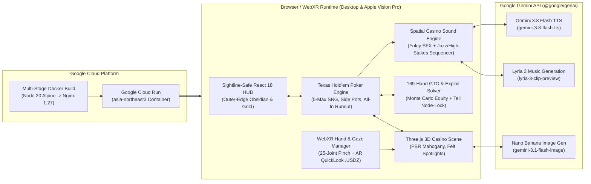

# Monte Carlo VIP 3D / WebXR Poker Casino

Live deployment on Google Cloud Run: [https://vr-poker-casino-668276194475.asia-northeast3.run.app](https://vr-poker-casino-668276194475.asia-northeast3.run.app)  
Team: Jawsbar (`Sanghoon Baek`)  
Repository: [https://github.com/jawsbaek/vr-poker-casino](https://github.com/jawsbaek/vr-poker-casino)

## 1. Overview

Monte Carlo VIP is a 3D Texas Hold'em No-Limit 5-Max Sit & Go played at a private high-roller table. It is built with Three.js, WebXR (hand tracking on Apple Vision Pro and Meta Quest), React 18, TypeScript, procedural 3D assets from Blender 5.2, and the Gemini media models through `@google/genai`. It runs on Google Cloud Run.

Most online poker is a flat 2D table with no one sitting at it. Here you sit with four 3D opponents and can read their body language:

- Opponents give physical tells. Bao (Seat #3) hunches over his phone scrolling short videos when his cards are weak or marginal; the screen throws cyan light on his face and you can hear the tinny speaker. When he has a monster hand he locks the phone and lays it flat on the mahogany rail (`🔥 Phone Down!`).
- Gemini 3.8 Flash TTS (`gemini-3.8-flash-tts`) voices the dealer and the AI players, Lyria 3 (`lyria-3-clip-preview`) switches the soundtrack between lounge jazz and high-stakes tension, and Nano Banana (`gemini-3.1-flash-image`) draws the character portraits. Without an API key, a WebAudio and canvas synthesizer takes over, and the table still runs at 60 to 90 FPS.
- A GTO solver computes Monte Carlo equity, pot odds, stack-to-pot ratio (SPR) and a full $13 \times 13$ starting-hand matrix. It recommends either pure Nash equilibrium play (`pure_gto`) or a node-locked exploit (`exploit`), based on each opponent's VPIP/PFR/AF stats and physical tells.
- The HUD is obsidian and champagne gold and sits at the screen edges, so it never covers the dealer, the AI players or the board. Headless GPU Playwright runs check this with bounding-box audits (`npm run dogfood` and `npm run verify:ux`).

## 2. Features

### AI opponents and their tells

Four AI players sit outside the mahogany armrest, alongside the dealer. Their meshes are generated in Blender (`vip_dealer.glb`, `vip_ai_players.glb`, `vip_cards_and_chips.glb`, `vip_poker_table.glb`), and a `.usdz` export supports AR Quick Look on Apple Vision Pro.

| Seat | Persona | Archetype | Prop and tell |
| :--- | :--- | :--- | :--- |
| Dealer | VIP Croupier | Professional | Gold silk bow tie; double-taps the felt before burning and dealing the flop, turn and river |
| Seat #1 | Viktor | Tight-aggressive shark | Glances at his gold wristwatch (`⌚ Checks Watch`) with high-equity value hands |
| Seat #2 | Elena | Ultra-tight rock | Sits upright with a champagne flute (`✨ Poised`) when she enters a pot strong |
| Seat #3 | Bao | Loose-passive calling station | Scrolls his phone (`📱 Scrolling`) with audible speaker leak on weak and medium hands; lays it flat on the rail (`🔥 Phone Down!`) on monster hands |
| Seat #4 | Marcus | Loose-aggressive maniac | Fidgets with his chip stack (`🎲 Chip Fidget`) when he runs a high-variance bluff |

### $13 \times 13$ GTO solver with node locking

The grid shows raise, call and fold frequencies for all 169 starting hands, from `AA` to `72o`. The exploit engine feeds observed tells (such as Bao's `phone_down_monster` or Marcus's `chip_fidget_bluff`) and HUD stats (`VPIP`, `PFR`, `3-Bet`, `AF`) into the calculation, then reports the expected value ($\text{EV}$) difference and grades each decision after you make it.

### Gemini audio and images (`@google/genai`)

`gemini-3.8-flash-tts` voices the croupier (`Aoede`) and the AI players (`Charon`, `Fenrir`, `Puck`, `Kore`). If it is unavailable, the game falls back to Web Speech and formant synthesis tuned per persona.

`lyria-3-clip-preview` plays late-night lounge jazz (`lounge_jazz`) and switches to a sub-bass showdown track (`high_stakes`) during all-in runouts or when a monster tell fires.

Casino sound effects are synthesized: a 14-flutter riffle shuffle, band-passed card slides on felt, clay chip clinks at several frequencies, double table knocks, and a fanfare at showdown.

### WebXR and Apple Vision Pro (`visionOS`)

`WebXRManager.ts` handles 25-joint hand tracking and ray input in one place. On Apple Vision Pro and Meta Quest you look and pinch (`transient-pointer` gaze plus thumb-index pinch); on desktop you use the mouse.

At the table you drag chips into the gold betting ring to stage a bet, hold `Space` or drag a card corner to peel your hole cards, and double-tap the felt to check.

`/public/models/vip_poker_table.usdz` and `/public/models/vision_pro_ergonomics_report.json` open in visionOS Safari's AR Quick Look at 1:1 room scale.

## 3. System architecture



## 4. Screenshots from the dogfooding run

`npm run dogfood` and `npm run verify:ux` check all 7 scripted poker scenarios and 6 camera presets, with 0 console errors, 0 page errors and a 100% pass rate on the spatial collision and sightline checks.

| Capture | Scenario and camera preset |
| :--- | :--- |
|  | 00. Title screen (`3D Orbit`): the suite, the cast preview and the Vision Pro test suite |
|  | 01. Seat #0 POV (`Composite HUD`): the edge HUD covers 0% of the dealer and AI players |
|  | 02. Hole card peel, close up: a 3D corner peel showing `A♠ J♠`, with 4 chip stacks |
|  | 03. Bao scrolling (`Seat #3`): lit phone screen, cyan glow on his face, audible speaker leak |
|  | 04. Bao's monster tell (`🔥 Phone Down!`): phone flat on the rail, Bao leaning forward |
|  | 05. Royal flush showdown: the 5 winning cards lift and glow gold under the spotlights |

## 5. Running and deploying

### Local development
```bash
# 1. Install dependencies
npm install

# 2. (Optional) Set your Gemini API key for live Gemini 3.8 TTS & Lyria 3 audio
export VITE_GEMINI_API_KEY="your-gemini-api-key"

# 3. Start development server on http://localhost:3000
npm run dev
```

### Visual dogfooding and UX guideline checks
```bash
# Run full 7-scenario + 6-camera spatial audit & screenshot loop
npm run dogfood

# Verify sightline-safe HUD ergonomics & bounding-box non-occlusion
npm run verify:ux
```

### Deploying to Google Cloud Run
The repository has a multi-stage `Dockerfile` and an `nginx.conf` that sets the right headers for `.glb`, `.usdz` and WebXR permissions. The container listens on port `8080`:
```bash
gcloud run deploy vr-poker-casino \
  --source . \
  --region asia-northeast3 \
  --allow-unauthenticated \
  --port 8080
```
